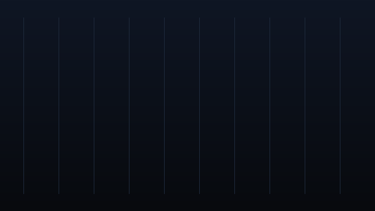
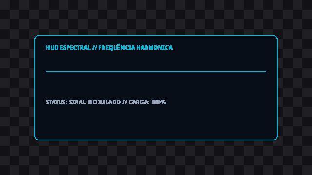
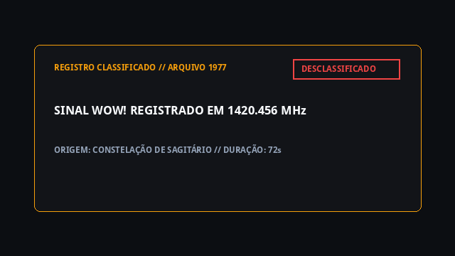

<!-- This file is automatically generated by scripts/sync_readme.py. -->

# 🎬 Python Motion Design Agent Skills

<p align="center">
  <a href="https://www.python.org/"></a>
  <a href="https://ffmpeg.org/"></a>
  
  
  
  <a href="./LICENSE"></a>
</p>

<p align="center">
  <a href="https://colab.research.google.com/github/Ru4nC/skills-motion-design/blob/main/examples/motion_design_showcase.ipynb"></a>
</p>

> **Coleção oficial de Agent Skills de Motion Design de alta performance em Python puro.**
> Proporcione aos seus agentes de IA (Claude Code, Antigravity, Cursor, Codex) a capacidade de conceber, animar, renderizar e compor **tanto cenas completas de tela cheia (100% preenchidas em `.mp4`) quanto overlays transparentes com canal alfa real (`.webm`)**, sem depender de Node.js, Chromium, Puppeteer ou arquivos temporários em disco.

---

## ✨ Galeria de Demonstração (Showcase)

Abaixo estão exemplos reais gerados em milissegundos pelo motor Python (Pillow + NumPy + FFmpeg):

| 📺 Cena Full-Screen (100% Preenchida) | 🎭 Overlay Transparente (Canal Alfa Real) | 📑 Dossiê Investigativo (Rough Notation) |
|:---:|:---:|:---:|
| <br><sub><b>.mp4 H.264</b> • Gradiente procedural & roll-up numérico</sub> | <br><sub><b>.webm VP9</b> • Fundo xadrez comprovando canal alfa</sub> | <br><sub><b>Rough Notation</b> • Perturbação senoidal com NumPy</sub> |

💡 **Experimente agora mesmo sem instalar nada localmente:** Abra o [**Notebook Interativo no Google Colab**](https://colab.research.google.com/github/Ru4nC/skills-motion-design/blob/main/examples/motion_design_showcase.ipynb) para renderizar esses e outros exemplos diretamente no seu navegador.

---

## ⚡ Por Que Esta Stack?

A maioria das soluções de animação programática depende de ecossistemas web pesados (React, Node.js, navegadores headless via Puppeteer/Chromium), o que gera latência de inicialização, consumo excessivo de RAM e dependências frágeis em pipelines de produção.

Esta suíte foi construída sob o paradigma **Python-First**: os quadros são sintetizados em milissegundos na memória com **Pillow + NumPy** e transmitidos diretamente via pipe (`stdin`) para o binário do **FFmpeg**, alcançando uma velocidade incomparável de **~1.2s a ~1.5 segundos por clipe animado** em dois modos:

1. 📺 **Cenas Full-Screen (100% Preenchidas)**: Telas completas (infográficos explicativos densos, vinhetas de título, diagramas conceituais com gradientes escuros procedurais) codificadas em `.mp4` (H.264 `yuv420p`) para compor diretamente a trilha de corte principal.
2. 🎭 **Overlays com Canal Alfa Real**: Elementos flutuantes (telemetria HUD, cartões de dados, grifos manuais e lower thirds) codificados em `.webm` (VP9 `yuva420p` com `-auto-alt-ref 0`) para sobreposição translúcida perfeita sobre b-roll.

```
 ┌─────────────────────────────────────────────────────────┐
 │             ESPECIFICAÇÃO DECLARATIVA (JSON)            │
 └────────────────────────────┬────────────────────────────┘
                              │
                              ▼
 ┌─────────────────────────────────────────────────────────┐
 │          MOTOR GRÁFICO EM MEMÓRIA (Pillow + NumPy)      │
 │   • Cenas Full-Screen com gradientes escuros contínuos  │
 │   • Marca-texto orgânico senoidal (Rough Notation)      │
 │   • Motion blur direcional derivativo cúbico            │
 │   • Osciloscópios harmônicos & retículas cartográficas  │
 │   • EaseOutExpo, roll-up & sombras suaves de 5 camadas  │
 └────────────────────────────┬────────────────────────────┘
                              │ bytes rawvideo RGBA (stdin pipe)
                              ▼
 ┌─────────────────────────────────────────────────────────┐
 │            FFMPEG STREAMING ENCODER EM MEMÓRIA          │
 ├────────────────────────────┬────────────────────────────┤
 │ Modo Full-Screen (.mp4)    │ Modo Overlay Alfa (.webm)  │
 │ libx264 -pix_fmt yuv420p   │ libvpx-vp9 yuva420p alpha  │
 └────────────────────────────┴────────────────────────────┘
                              │ clipe gerado em ~1.5s
                              ▼
 ┌─────────────────────────────────────────────────────────┐
 │   COMPOSIÇÃO NA TIMELINE (filter_complex + PTS Shift)   │
 └─────────────────────────────────────────────────────────┘
```

---

## 🚀 Destaques Arquiteturais

| Recurso | Detalhes Técnicos |
|---|---|
| 🏎️ **Streaming em Memória** | Zero arquivos PNG intermediários em disco; fluxo contínuo de bytes RGBA para o FFmpeg. |
| 📺 **Suporte Full-Screen & Alfa** | Flexibilidade total: exporta tanto `.mp4` opaco (100% preenchido) quanto `.webm` com canal alfa real. |
| ⏱️ **Sincronia com PTS Shift** | Deslocamento de timestamp (`setpts=PTS-STARTPTS+{t_start}/TB`) eliminando congelamento de quadros. |
| 📐 **Safe Area Contextual** | Margem perimetral obrigatória de 10% em 1080p e zona restrita de 12% a 38% em Shorts (9:16). |
| 🎨 **Paleta Obsidian & Amber** | Contraste de alto impacto cinemático com base `#0A0B0E`, acentos `#F59E0B`, ciano elétrico e carmesim. |
| 🧪 **Google Colab & Jupyter** | Widget `InlineAlphaPreview` com fundo quadriculado dinâmico para comprovação de transparência. |

---

## 📚 Catálogo Oficial de Skills

| Skill | Descrição | Exemplo de Prompt |
|---|---|---|
| **[`/motion-best-practices`](./skills/motion-best-practices/SKILL.md)** | Diretrizes essenciais de arquitetura Python-First, determinismo offline, Safe Area, paleta cinemática e sincronia para Motion Design. | `Verifique se os elementos respeitam a Safe Area de 10% e a paleta Obsidian & Amber.` |
| **[`/motion-captions`](./skills/motion-captions/SKILL.md)** | Geração e formatação de legendas dinâmicas virais (Bebas Neue #FFFF00, contorno grosso, 3 palavras/cue) em Python. | `Formate legendas dinâmicas virais com tipografia condensada amarela, contorno preto de 8px e 3 palavras por cue.` |
| **[`/motion-composition`](./skills/motion-composition/SKILL.md)** | Composição de overlays na timeline via filter_complex do FFmpeg, ajuste de apresentação (PTS Shift) e sincronia temporal. | `Monte o filter_complex com PTS Shift para sobrepor 3 overlays sincronizados na timeline.` |
| **[`/motion-create`](./skills/motion-create/SKILL.md)** | Scaffolding e estrutura recomendada para criação de novos módulos de Motion Design em Python. | `Crie o scaffolding estrutural para um novo módulo de infografia animada.` |
| **[`/motion-interactivity`](./skills/motion-interactivity/SKILL.md)** | Parametrização declarativa via JSON e controle temporal de keyframes para animações em Python. | `Defina o esquema declarativo JSON para parametrização dinâmica de keyframes.` |
| **[`/motion-maps`](./skills/motion-maps/SKILL.md)** | Animações de mapas cinemáticos, retículas polares HUD, coordenadas e radares pulsantes em Python. | `Desenhe uma retícula cartográfica HUD com radar pulsante em coordenadas GPS.` |
| **[`/motion-markup`](./skills/motion-markup/SKILL.md)** | Primitivas de renderização gráfica em memória (Pillow + NumPy), tipografia, efeitos visuais e animações matemáticas em Python. | `Crie um infográfico de tela cheia com gradiente espacial ou um card de telemetria com Rough Notation.` |
| **[`/motion-multimedia`](./skills/motion-multimedia/SKILL.md)** | Extração de metadados de vídeo e áudio (dimensões, fps, duração, canais) usando FFprobe e Python puro. | `Inspecione dimensões e duração exata de áudio usando FFprobe em Python puro.` |
| **[`/motion-notebooks`](./skills/motion-notebooks/SKILL.md)** | Prototipagem, renderização e inspeção de animações com canal alfa em Google Colab e Jupyter Notebooks. | `Configure uma célula no Google Colab com InlineAlphaPreview para validar a transparência do vídeo.` |
| **[`/motion-render`](./skills/motion-render/SKILL.md)** | Renderização em memória e streaming contínuo para FFmpeg gerando cenas de tela cheia (.mp4 H.264) ou overlays transparentes (.webm VP9 yuva420p). | `Renderize uma cena full-screen em .mp4 H.264 ou um overlay transparente em .webm VP9 yuva420p.` |
| **[`/motion-studio`](./skills/motion-studio/SKILL.md)** | Paridade visual entre o motor Python e Canvas 2D em navegador, inspeção offline com ffplay e exportação de stills. | `Implemente a função window.renderAutomationFrame no Canvas 2D garantindo paridade matemática com o Pillow.` |

---

## 🛠️ Como Utilizar com Agentes de IA

### 1. Claude Code / Antigravity / Codex
Para que seu agente carregue automaticamente todas as skills, adicione este repositório ao caminho de descoberta de skills do seu projeto:

```bash
# Clonar o repositório na pasta de skills do seu projeto
git clone https://github.com/Ru4nC/skills-motion-design.git .agents/skills/motion-design
```

### 2. Validação e Sincronização Local
O repositório inclui utilitários em Python puro para auditar frontmatters, links e integridade de código:

```bash
# Executa o teste de integridade em todas as skills
python scripts/validate_skills.py

# Regenera a tabela do README a partir dos metadados das skills
python scripts/sync_readme.py
```

---

## 🧠 Integração com Google NotebookLM

Se você utiliza o **Google NotebookLM** para estudos, pesquisas ou geração de áudio explicativo, disponibilizamos uma fonte estruturada consolidada em [`docs/notebooklm_source.md`](./docs/notebooklm_source.md), pronta para importação direta.

---

## 📄 Licença

Distribuído sob a licença **MIT**. Consulte [`LICENSE`](./LICENSE) para mais informações.
